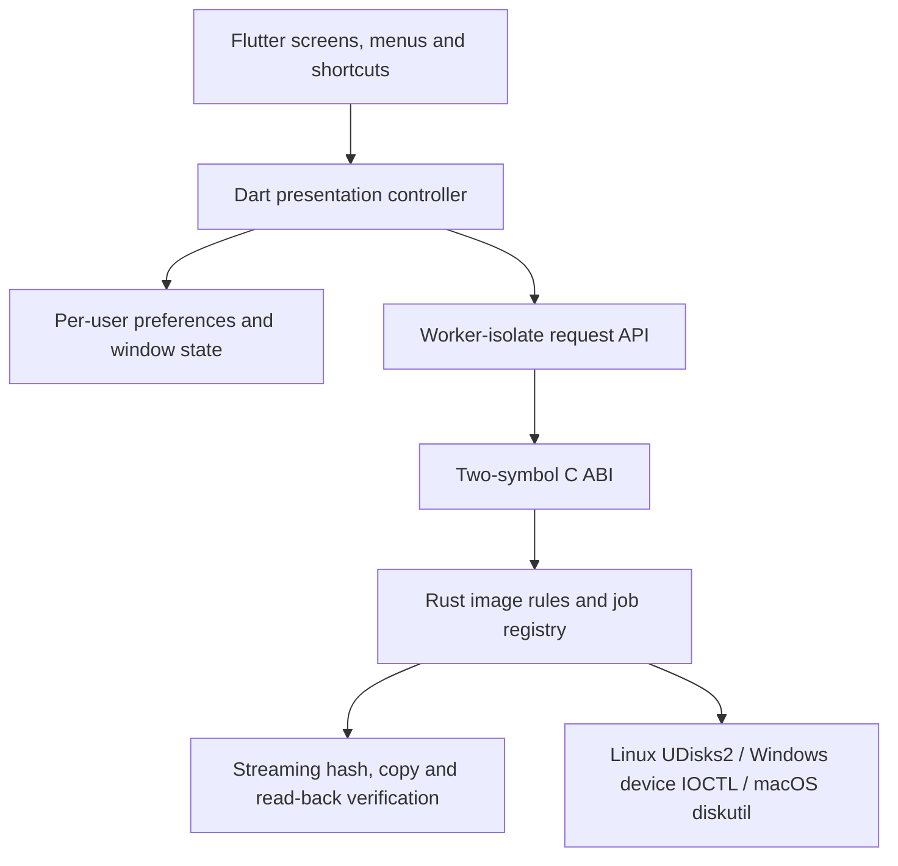

# Architecture

Flutter is the canonical desktop implementation. The retained Tauri/Svelte tree
is migration reference material, not a dependency of the Flutter app.

## Responsibility and state

`lib/ui` owns layouts, focus, controls, menus, desktop actions and confirmation
and failure dialogs. `AppController` owns current selection, loading state,
checksum display, operation polling and presentation lifecycle. It snapshots
write inputs and suppresses racing source changes. `Preferences` owns lightweight
per-user theme/options/window state through shared_preferences; explicit settings
imports preserve a prior JSON snapshot and never modify legacy WebView storage.
`Diagnostics` provides a single categorized stream, with bounded on-disk history
and no input paths or request contents in persistent logs.

`packages/gosh_core/rust` owns file inspection, SHA-256/MD5, device identity and
eligibility, authoritative preflight, capacity/source checks, exclusive device
access, write/verify jobs, cancellation and structured domain failures. Widgets,
BuildContext, colors and navigation never reach Rust. DTOs in `lib/models.dart`
only represent bridge results; Dart does not duplicate image parsing or stream
writing rules.

## Bridge choice and ownership

flutter_rust_bridge 2.13 was considered: it supports desktop platforms, generated
DTOs and async bindings but adds generator/toolchain integration and runtime
machinery. This application's coarse JSON operation set fits direct FFI with
only two symbols, `gosh_call` and `gosh_free`. The unsafe code stays in `ffi.rs`
and Windows' documented synchronous DeviceIoControl call; domain code is safe
Rust. There is no handwritten pointer graph, native callback or generated binding
file to keep stale. This choice can be revisited if the API grows substantially.

Dart allocates a bounded UTF-8 request buffer and releases it in finally. Rust
borrows it synchronously, parses/validates the request, and returns a Rust-owned
NUL-terminated JSON envelope. Dart copies/decodes that envelope and calls
`gosh_free` exactly once in finally. Rust never retains the request pointer.
Concurrent calls are supported; only one write job is allowed. Recoverable errors
have explicit categories; panics are caught at the ABI and worker boundaries.

All native calls run in worker isolates, not in build methods or UI callbacks.
Hashing is one coarse request. Writes start a worker job; Dart polls one progress
DTO at 200 ms intervals and can request cancellation. The worker checks cancellation
between bounded chunks (including preflight hashing) and synchronizes the target
before terminal status. Logical sector geometry is queried by each adapter; the
stream engine zero-pads only the final partial sector and verifies both image
bytes and padding. Capacity checks include that padded tail.
Closing during writing requests cancellation and waits for a terminal state.
No callback can outlive a disposed widget. Synchronous OS authorization or device I/O may delay
cancellation until the OS call returns.

## Native assets and platforms

`packages/gosh_core/hook/build.dart` maps OS/architecture to a Rust target, builds
with the source-controlled lockfile, declares source dependencies and adds a bundled
native code asset. Flutter copies the corresponding .so/.dll/.dylib into each
application's runtime bundle. This is the only Rust build path for the UI; CI
also checks the core independently. Generated platform registrants remain owned
by Flutter. Core API changes require changing matching DTO decoding and bridge
contract tests; no generator invocation is required.

Linux discovery reads sysfs and exact partition mounts, excludes mounted system
disks and active device-mapper/LVM/RAID holders, and validates identity immediately before opening. USB connection numbers (or
device-node creation time for non-USB removable devices) distinguish reconnects
even when a serial is absent. Direct exclusive access
uses O_EXCL; when permission is denied, UDisks2.OpenDevice supplies an authorized
FD. Unmount/eject use UDisks2 and visible errors. Flatpak grants UDisks2 bus access
and devices; GTK_USE_PORTAL=1 routes native file dialogs through portals. It has
no blanket host-filesystem or network grant.
Windows excludes boot/system disks, locks and dismounts discovered volumes and
holds the locks during writing; eject uses a storage IOCTL. macOS parses diskutil
plists, handles whole-disk names correctly, gathers partition and APFS physical-store volume mounts and rejects
external system volumes. Its approved App Sandbox exception permits raw-device access; Unix device
write permission still requires elevation and native testing. Cross-target compilation cannot validate
OS authorization, hotplug races, disk locking, driver behavior or raw I/O.

## Remaining release gates

Actual Windows/macOS builds and QA, disposable-drive writing on each OS, and
macOS device-authorization testing remain outstanding. Device serials are not universally
available; physical hotplug/race tests must validate the identity strategy. No
claim of production safety or completed migration is based on file fixtures alone.
